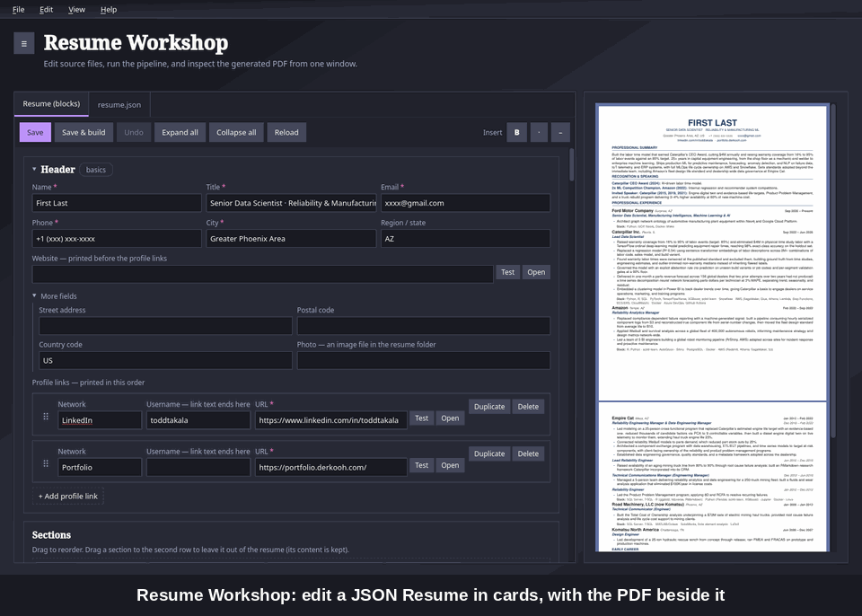
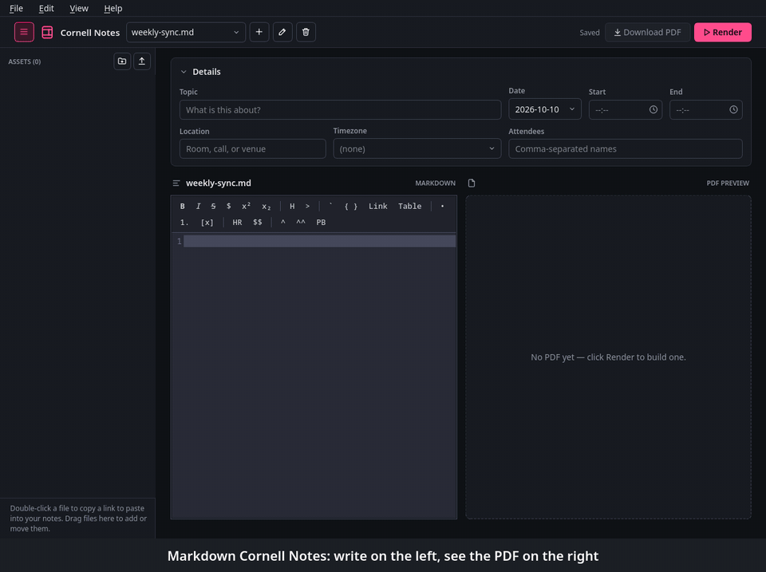

[{: .avatar}](https://www.linkedin.com/in/toddtakala)

I built the labor time model that earned Caterpillar's CEO Award, raising warranty coverage from 16% to 95% of labor events and eliminating $4M in physical time study labor. I got there from the shop floor: I started as a heavy equipment mechanic and welder, earned a mechanical engineering degree from Arizona State University, and have spent more than 25 years in capital equipment engineering.

Today I ship production machine learning for predictive maintenance, forecasting, anomaly detection, and NLP, working from failure data, IoT telemetry, and ERP systems and owning the full MLOps lifecycle. Having done the work on both ends, I'm trusted by technicians and executives alike.

[LinkedIn](https://www.linkedin.com/in/toddtakala) · [GitHub](https://github.com/forloop11)

## Selected Work

### Predicting repair labor times with deep learning

Caterpillar Inc. · Lead Data Scientist · CEO Award, May 2024
{: .meta}

**Problem.** Warranty coverage stood at 16% of labor events against an 85% target, and repair times were set through physical time studies.

**Approach.** I built a TensorFlow ordinal deep-learning model that predicts equipment repair times from sentence-transformer embeddings of labor descriptions, across more than 2 million combinations of labor code, sales model, and build variant. It replaced a regression model with an R² of 0.54. Warranty labor times turned out to be censored at the published standard, so I excluded them and built ground truth from time studies, engineering estimates, and outlier-trimmed non-warranty medians. The model abstains on unseen build variants and job codes, and each segment must pass a 90% validation gate.

**Result.** Coverage rose to 95% of labor events, $4M in physical time study labor was eliminated, and the model reached 98% exact-class accuracy on the holdout set.

### A diesel engine digital twin for mining haul trucks

Empire Cat · Reliability Engineering Manager & Data Engineering Manager
{: .meta}

**Problem.** Caterpillar's engine life target for large off-highway trucks was an estimate, not something derived from evidence.

**Approach.** I led the modeling on a 25-person cross-functional program. Principal component analysis reduced thousands of candidate factors to 9 controllable variables, and a digital twin of the diesel engine monitored those variables on live telemetry.

**Result.** Haul truck engine life was extended 23%, and the client saved $62M in the first 90 days. I presented the work at Caterpillar as an invited speaker in May 2021.

### Measuring true component life across a robot fleet

Amazon · Reliability Analytics Manager
{: .meta}

**Problem.** Failure reporting depended on people complying with a reporting process, so component life data was only as good as that compliance.

**Approach.** I built a pipeline that consumes hourly serialized component logs from S3 and reconstructs true component life from serial-number changes, then applied Weibull and survival analysis across a global fleet of 400,000 autonomous robots. I also led a team of 5 BI engineers building a global robot monitoring pipeline in R/Shiny on AWS.

**Result.** The fleet design standard moved from average life to B10, the analysis informed maintenance strategy and design metrics network-wide, and the monitoring pipeline was adopted across sites for incident response and proactive maintenance.

### Forecasting parts revenue for 156 dealers

Caterpillar Inc. · Lead Data Scientist
{: .meta}

**Problem.** Two earlier attempts over two years had not produced a parts revenue forecast across Caterpillar's global dealers.

**Approach.** I built a time series decomposition neural network that forecasts parts dollars per technician, separating trend, seasonality, and residual.

**Result.** Delivered in one month, covering 156 global dealers at 3% MAPE.

## Featured Projects

### [Resume Workshop](https://github.com/forloop11/resume-workshop)

A source-driven LaTeX resume builder. The resume's content lives in a single [JSON Resume](https://jsonresume.org/schema) document, and standard-library Python generators and Make targets turn it into a PDF, a plain-text resume, and a [Reactive Resume](https://rxresu.me) export. Includes an optional Electron desktop editor with a drag-and-drop block view, and a Docker-based build for a reproducible toolchain.

### [Markdown Cornell Notes](https://github.com/forloop11/markdown-cornell-notes)

Take meeting notes in Markdown and render them as Cornell-style PDFs with LaTeX. Each page has a header, a notes panel with a cue column beside it, and a summary band, all generated from YAML and Markdown files. Includes an optional desktop editor for writing notes beside their PDF, with autosave, one-click rendering, and light and dark themes. [Download the latest release](https://github.com/forloop11/markdown-cornell-notes/releases).

[More projects](projects.html)

## Experience

| Dates | Role | Employer |
| ---   | ---  | ---      |
| Sep 2026 – Present | Senior Data Scientist, Manufacturing Intelligence, Machine Learning & AI | Ford Motor Company |
| Sep 2022 – Jun 2026 | Lead Data Scientist | Caterpillar Inc. |
| Feb 2022 – Sep 2022 | Reliability Analytics Manager | Amazon |
| Dec 2016 – Feb 2022 | Reliability Engineering Manager & Data Engineering Manager | Empire Cat |
| Jun 2016 – Dec 2016 | Lead Reliability Engineer | Empire Cat |
| Dec 2012 – Jun 2016 | Technical Communications Manager (Engineering Manager) | Empire Cat |
| Jan 2012 – Dec 2012 | Reliability Engineer | Empire Cat |
| Jan 2008 – Jan 2012 | Technical Communicator (Engineer) | Road Machinery, LLC (now Komatsu) |
| Jun 2006 – Dec 2007 | Design Engineer | Komatsu North America |
| Early career | Heavy Equipment Operator and Mechanic; Engineering Intern | |
{: .timeline}

## Skills

* **Machine Learning & AI:** deep learning (PyTorch, TensorFlow/Keras), time series forecasting, anomaly detection, survival analysis and censored data, ordinal regression, NLP and embeddings, design of experiments
* **MLOps, Data & Cloud:** AWS SageMaker, Google Cloud Platform, Snowflake, CI/CD and Infrastructure as Code, Docker, model governance, validation gates, and drift detection, automated retraining, ETL/ELT pipelines, knowledge graphs and ontologies (Neo4j), data architecture and governance, Linux
* **Reliability Engineering:** root cause failure analysis, 8D and 5 Whys, FMEA / DFMEA / PFMEA, FRACAS, Weibull analysis, prognostics and remaining useful life, condition monitoring, oil tribology and spectroscopy, life cycle cost analysis
* **Domain Expertise:** heavy equipment, mining, automotive and manufacturing, fleet and maintenance management, warranty and service operations, supply chain and demand planning

## Awards and Honors

### CEO Award (Labor Time Machine Learning)

_Jim Umpleby, Caterpillar Inc. - May 2024_

Developed AI-driven solutions that reduced labor costs and earned the CEO award for exceptional personal contributions and business impact.

### 2x Champion: Amazon Machine Learning Competition

_Amazon Machine Learning University - September 2022_

2x winner of machine learning internal competitions at Amazon.com for regression and recommender system data science competitions.

### Invited Speaker: Data Science Applications for Fleet Reliability

_Caterpillar Inc. - May 2021_

Shared diesel engine digital twin for large off-highway trucks. Life was extended by 23%, which saved our client $62M in the first 90 days.

### Invited Speaker: Truck Rebuild Program

_Caterpillar Inc. - April 2019_

Spoke at Caterpillar large mining truck conference to discuss Empire-Cat’s truck rebuild program. Empire will completely rebuild a mining haul trucks at 60% of the cost of a new machine and operates with 2 to 4% more physical availability above trucks from the factory.

### Invited Speaker: Product Problem Management

_Caterpillar Inc. - September 2015_

Discussed Empire's reliability engineering program which involves a focus on "find it" using RCA, critical component life analysis, inspections, telematics, and condition monitoring, followed by identifying key factors using machine learning, and then implementing "fix it" solutions through interim corrective actions and working with Caterpillar's FMEA process for permanent solutions.

## Education

* Bachelor of Science in Mechanical Engineering, Arizona State University
* Operating Engineer Apprenticeship Certificate, U.S. Department of Labor & I.U.O.E. Local 150 AISP

## Certifications

| Name | Issued By |
| ---  | ---       |
| [AWS Certified Machine Learning - Specialty (MLS-C01)](https://www.credly.com/badges/65a3c7d5-1977-4c71-94d6-2d016ea1fe29) | Amazon Web Services |
| [Lean Six Sigma Black Belt](https://www.coursera.org/account/accomplishments/specialization/3EOLHJ57IMRP) | Kennesaw State University |
| Applied Failure Analysis | Caterpillar Inc. |
| [SAFe 6 Agilist](https://www.credly.com/badges/a4c2f671-694e-46f5-bdd1-a1025d0e3b00) | SAFe by Scaled Agile, Inc. |
| [RAG and Agentic AI](https://www.coursera.org/account/accomplishments/professional-cert/1XWIEFNB5MPF) | IBM |

[All certifications and course certificates](credentials.html)
